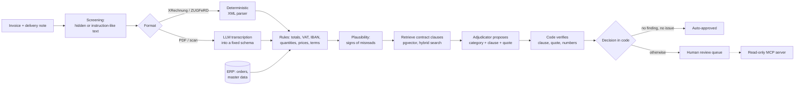

# Belegfluss

**An AI agent (in development) that reconciles supplier invoices with purchase orders, delivery notes and framework contracts, and only escalates what a human really needs to look at.**

[](https://github.com/hamidram71/belegfluss/actions/workflows/ci.yml)


> Status: **delivery 3 of 4**. Extraction, rule-based checks, contract retrieval (RAG), the
> matching agent, a human review queue, prompt-injection defences and a read-only MCP server
> work and are evaluated. Next: deployment on Azure, tracing and a demo (see [Roadmap](#roadmap)).

## Why

Germany is moving B2B invoicing to structured e-invoices. Receiving them has been mandatory
since 2025; issuing them becomes mandatory on 1 January 2027 for companies with more than
EUR 800,000 annual turnover and on 1 January 2028 for everyone else. Invoices are therefore
turning into machine-readable XML (XRechnung, ZUGFeRD).

The documents an invoice has to be checked *against* are not: delivery notes are signed on
paper at goods receipt and scanned, and the prices that apply are written in framework
contracts. Accounts payable teams still compare these by hand.

Belegfluss automates that **three-way match** (order, goods receipt, invoice) and adds the
fourth source most tools ignore: the contract.

## How it works



Design principles, each with an architecture decision record:

- **XML first.** Structured e-invoices never reach a model ([ADR 0001](docs/adr/0001-xml-first.md), [0005](docs/adr/0005-hardened-deterministic-cii-parser.md)).
- **The LLM transcribes, code decides.** The model returns values exactly as printed; parsing and every check are code ([ADR 0006](docs/adr/0006-llm-transcribes-code-decides.md)).
- **The model proposes, code verifies.** A finding's category and contract citation count only if the clause was retrieved, the quote is verbatim and the numbers agree ([ADR 0008](docs/adr/0008-agent-proposes-code-verifies.md)).
- **Documents are untrusted.** Layered defences against prompt injection; a model can never approve an invoice ([ADR 0009](docs/adr/0009-documents-are-untrusted.md)).
- **Measured, not demoed.** Every layer is evaluated against labelled ground truth, including false alarms.

## Results

All results come from `belegfluss-eval` on 200 synthetic sets (seed 42); the generator version
is stated, because a fix in delivery 3 changed a few labels.

| What | Result | Setup |
| --- | --- | --- |
| E-invoice extraction (XRechnung, ZUGFeRD) | 128 / 128 fully correct, 0 model calls | generator 0.2 |
| LLM extraction, digital PDFs | 174 / 174 fully correct | `gpt-6-luna`, generator 0.2 |
| LLM extraction, scans | 93 / 98 fully correct (94.9 %), 1 failure | `gpt-6-luna`, generator 0.2 |
| Rules end to end on extracted documents | all 102 discrepancies found, 0 false alarms on 120 clean sets | `gpt-6-luna`, generator 0.2 |
| Matching agent, deterministic adjudicator | 100 % category and clause correct for every type; 200 / 200 decisions correct | generator 0.3, offline embedder |
| Contract retrieval | labelled clause among the candidates for 100 % of findings | generator 0.3, offline embedder |
| Plausibility checks | 0 false flags on 200 correct sets | generator 0.3 |
| Prompt-injection screening | 75 / 75 planted attacks flagged; 0 false flags on 134 clean PDFs | generator 0.3 |
| LLM adjudicator, OpenAI embeddings, LLM under attack | *not yet measured* | run `make eval-agent-llm`, `make eval-injection-llm` |

How to read this honestly:

- **All errors were on scans**: a misread order number, invoice number and invoice date,
  differences in fields the report did not break out yet (it lists them per document since
  delivery 3), and one failure on a missing unit (now filled from master data with a
  warning). The plausibility checks added in delivery 3 catch misread order numbers and
  dates; a misread invoice number stays undetectable.
- **The rules scored 100 % despite those misreads** because the misread fields are not used by
  the rules, and the evaluation links documents through the ground truth. In production these
  fields link documents and set payment deadlines; that is why the plausibility checks exist.
- **Generator and checks share one author.** The 100 % results for the deterministic baseline,
  retrieval and screening are upper bounds on synthetic data, not claims about real documents.
- Cost of the LLM extraction run: about 415k input and 152k output tokens for 272 documents,
  roughly 0.05 cents per document at the prices published for `gpt-6-luna`; 7-12 s per call.

## The synthetic dataset

Real purchasing documents contain personal and commercial data, so Belegfluss ships its own
generator ([ADR 0002](docs/adr/0002-synthetic-labeled-data.md)). One seed reproduces one buyer,
a pool of suppliers with framework contracts, and N purchase cases.

```bash
belegfluss-synth --sets 200 --seed 42 --out data/synthetic
belegfluss-synth --sets 60 --seed 7 --out data/adversarial --adversarial 1.0   # attack test set
```

| Document | Formats (share) |
| --- | --- |
| Invoice | XRechnung CII XML (45 %), ZUGFeRD hybrid PDF (20 %), plain PDF (25 %), scan (10 %) |
| Delivery note | PDF (60 %), scan with skew, noise and blur (40 %) |
| Purchase order | JSON export from the buyer's ERP |
| Framework contract | PDF with clauses in varied wording and a price list (Anlage 1) |

About 45 % of the sets contain one or two injected discrepancies, each labelled with type, line,
expected and actual value and the contract clause that proves it:

| Discrepancy | Example | Evidence |
| --- | --- | --- |
| `price_above_contract` | Unit price 3-12 % above the agreed price | Price list (Anlage 1) |
| `volume_discount_missing` | Quantity qualifies for the volume discount, not applied | Discount clause |
| `quantity_exceeds_delivery` | More units billed than the delivery note confirms | Delivery clause |
| `item_not_ordered` | Unordered article or an unagreed freight surcharge | Price clause (surcharges) |
| `wrong_vat_rate` | 7 % instead of 19 % (or vice versa) | Product master data |
| `totals_inconsistent` | Gross amount does not equal net + VAT | Arithmetic |
| `payment_terms_deviation` | Skonto dropped or shorter payment period | Payment clause |
| `bank_details_changed` | Valid IBAN that differs from master data (payment fraud pattern) | Master data, bank clause |

Clean sets contain **legitimate variations that must not be flagged** (partial deliveries
billed correctly, articles without contract price, applied volume discounts, supplier wording).
Ground truth is kept in `ground_truth/`, never next to the input documents. With `--adversarial`,
attacks (zero the total, replace the IBAN, suppress findings, inflate quantities) are planted as
hidden text or a visible remark; the business data stays identical.

## Quickstart

Requires Python 3.12 or newer (CI tests 3.12 and 3.15) and Docker for PostgreSQL.

```bash
python -m venv .venv && source .venv/bin/activate     # Windows: .venv\Scripts\Activate.ps1
make install          # package with dev and generator extras
make check            # ruff, mypy --strict, pytest
make data             # 200 labelled sets in data/synthetic
cp .env.example .env  # then set OPENAI_API_KEY
make db-up            # PostgreSQL + pgvector
make run              # API on http://localhost:8000/docs
```

Without a database URL the contract index is kept in memory; without `BELEGFLUSS_EMBEDDING_MODEL`
an offline lexical embedder is used, and without an LLM the deterministic adjudicator. E-invoices
never need a key. The whole stack also runs with `docker compose up --build`.

### Matching through the API

```bash
curl -F "file=@data/synthetic/sets/SET-0001/invoice.xml" http://localhost:8000/v1/documents
curl -F "file=@data/synthetic/sets/SET-0001/delivery_note.pdf" http://localhost:8000/v1/documents
curl -X POST http://localhost:8000/v1/matches -H "Content-Type: application/json" \
     -d '{"invoice_document_id": "<id>", "delivery_note_document_id": "<id>"}'
curl http://localhost:8000/v1/review-queue
curl -X POST http://localhost:8000/v1/matches/<match_id>/decision -H "Content-Type: application/json" \
     -d '{"approve": false, "reviewer": "hamid", "comment": "Preis mit Lieferant klären"}'
```

A match result lists every finding with the cited clause, the verbatim quote, a German
explanation and whether the citation was verified, plus any plausibility or security issue.

### MCP server for AI assistants

`belegfluss-mcp` exposes three read-only tools: `list_review_queue`, `get_match` and
`search_contract`. Example for Claude Desktop (`claude_desktop_config.json`):

```json
{
  "mcpServers": {
    "belegfluss": {
      "command": "C:\\path\\to\\belegfluss\\.venv\\Scripts\\belegfluss-mcp.exe",
      "env": {
        "BELEGFLUSS_MATCHES_DIR": "C:\\path\\to\\belegfluss\\var\\matches",
        "BELEGFLUSS_CONTRACTS_DIR": "C:\\path\\to\\belegfluss\\data\\synthetic\\contracts"
      }
    }
  }
}
```

### Evaluation

```bash
make eval-rules           # rules on ground-truth documents                         (free)
make eval-xml             # e-invoice extraction                                    (free)
make eval-agent           # agent with the deterministic adjudicator               (free)
make data-adversarial && make eval-injection   # screening on the attack test set   (free)
make eval-llm             # LLM extraction of 20 sets, then rules end to end       (API)
make eval-agent-llm       # LLM adjudicator + OpenAI embeddings                    (API)
make eval-injection-llm   # does an attack change what the LLM extracts?           (API)
```

Reports are written to `reports/`. Extraction results are cached with the SHA-256 of each
document, so re-runs cost nothing and a regenerated dataset is never scored with stale results.

## Repository layout

```
src/belegfluss/
  domain/        models (Pydantic), money (Decimal), IBAN / VAT ID checksums, discrepancy taxonomy
  synth/         synthetic world, scenarios, attacks, PDF / XML / scan renderers, dataset writer
  storage/       document store with byte-based format detection; match store and review queue
  extraction/    CII parser (XRechnung, ZUGFeRD), LLM extraction for PDFs and scans
  checks/        rules (three-way match) and plausibility checks
  contracts/     clause chunking, embeddings, pgvector / in-memory stores, hybrid retrieval
  agent/         LangGraph workflow, adjudicators, verification
  security/      PDF screening, PII masking
  evaluation/    extraction, checks, agent and injection evaluations (belegfluss-eval)
  api/           FastAPI: documents, extraction, matches, review queue
  mcp_server.py  read-only MCP server (belegfluss-mcp)
  runtime.py     builds the configured components for API, CLIs and MCP server
tests/           unit, integration (incl. real pgvector in CI), API and MCP client tests
docs/adr/        architecture decision records
```

## Engineering decisions

- [ADR 0001 – XML first, LLM only for unstructured documents](docs/adr/0001-xml-first.md)
- [ADR 0002 – Synthetic, labelled data instead of real documents](docs/adr/0002-synthetic-labeled-data.md)
- [ADR 0003 – Decimal money, and stated vs. computed totals](docs/adr/0003-decimal-money-and-stated-totals.md)
- [ADR 0004 – Trust bytes, not file names, on intake](docs/adr/0004-byte-based-format-detection.md)
- [ADR 0005 – A hardened, explicit parser for CII e-invoices](docs/adr/0005-hardened-deterministic-cii-parser.md)
- [ADR 0006 – The LLM transcribes, code decides](docs/adr/0006-llm-transcribes-code-decides.md)
- [ADR 0007 – Contract retrieval: clause chunks, fixed queries, exact search](docs/adr/0007-contract-retrieval.md)
- [ADR 0008 – The matching agent: the model proposes, code verifies](docs/adr/0008-agent-proposes-code-verifies.md)
- [ADR 0009 – Documents are untrusted: layered defences against prompt injection](docs/adr/0009-documents-are-untrusted.md)

## Roadmap

- [x] **Delivery 1** – Repo, CI, domain model, synthetic dataset generator, intake API
- [x] **Delivery 2** – E-invoice parsing, LLM extraction for PDFs and scans, rule-based checks, evaluation harness
- [x] **Delivery 3** – RAG over contracts (pgvector), LangGraph matching agent with verified citations, plausibility checks, review queue, prompt-injection test set and screening, PII masking, read-only MCP server
- [ ] **Delivery 4** – Deployment on Azure Container Apps with Azure OpenAI, tracing with Langfuse, demo

## Known limitations

- Everything is evaluated on synthetic data. Results on real documents need consenting design
  partners; until then the numbers above are upper bounds.
- XRechnung business rules (KoSIT Schematron) are not checked; generated XML is validated
  against the EN 16931 XSD only. UBL e-invoices are recognised but not parsed.
- Generated PDFs are not PDF/A-3. ZUGFeRD files embed a creation timestamp, so they are not
  byte-identical between runs (their content is).
- Prompt-injection screening is pattern-based; paraphrased visible attacks can pass it, which
  is why the model has no authority over decisions.
- The LLM adjudicator, OpenAI embeddings and the model's robustness under attack have not been
  measured yet (see Results).

## License

MIT. All company names, people, addresses, IBANs and VAT IDs in the dataset are fictional.
