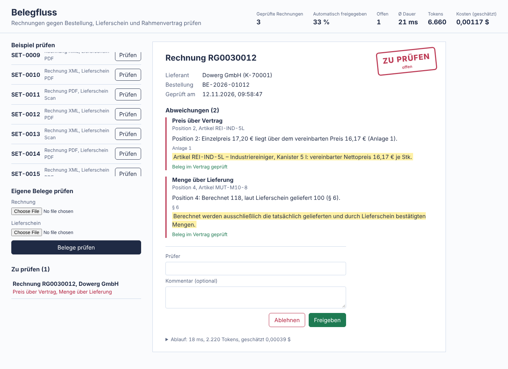
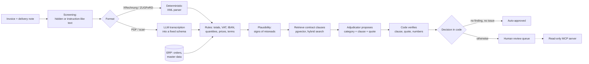

# Belegfluss

**An AI agent (in development) that reconciles supplier invoices with purchase orders, delivery notes and framework contracts, and only escalates what a human really needs to look at.**

[](https://github.com/<your-github-user>/belegfluss/actions/workflows/ci.yml)


> Status: **all four deliveries done.** Extraction, rule-based checks, contract retrieval
> (RAG), the matching agent, a review UI with a human decision step, prompt-injection
> defences, tracing, a read-only MCP server and an Azure deployment work and are evaluated
> with a real model.



## Why

Germany is moving B2B invoicing to structured e-invoices. Receiving them has been mandatory
since 2025; issuing them becomes mandatory on 1 January 2027 for companies with more than
EUR 800,000 annual turnover and on 1 January 2028 for everyone else. Invoices are therefore
turning into machine-readable XML (XRechnung, ZUGFeRD).

The documents an invoice has to be checked *against* are not: delivery notes are signed on
paper at goods receipt and scanned, and the prices that apply are written in framework
contracts. Accounts payable teams still compare these by hand.

Belegfluss automates that **three-way match** (order, goods receipt, invoice) and adds the
fourth source most tools ignore: the contract.

## How it works



Design principles, each with an architecture decision record:

- **XML first.** Structured e-invoices never reach a model ([ADR 0001](docs/adr/0001-xml-first.md), [0005](docs/adr/0005-hardened-deterministic-cii-parser.md)).
- **The LLM transcribes, code decides.** The model returns values exactly as printed; parsing and every check are code ([ADR 0006](docs/adr/0006-llm-transcribes-code-decides.md)).
- **The model proposes, code verifies, and is asked only when needed.** A finding's category and contract citation count only if the clause was retrieved, the quote is verbatim and the numbers agree. Measured against a rule-based baseline, the model added no accuracy on this data, so the default is hybrid: rules first, the model only where rules cannot decide ([ADR 0008](docs/adr/0008-agent-proposes-code-verifies.md)).
- **Documents are untrusted.** Layered defences against prompt injection; a model can never approve an invoice ([ADR 0009](docs/adr/0009-documents-are-untrusted.md)).
- **Measured, not demoed.** Every layer is evaluated against labelled ground truth, including false alarms.

## Results

Measured with `belegfluss-eval` on 200 synthetic sets (seed 42, generator 0.3.1) with
`gpt-6-luna` and `text-embedding-3-small`.

| What | Result |
| --- | --- |
| E-invoice extraction (XRechnung, ZUGFeRD) | 131 / 131 fully correct, no model calls |
| LLM extraction, digital PDFs | 173 / 173 fully correct |
| LLM extraction, scans | 89 / 96 fully correct; 94 / 96 correct in every decision-relevant field |
| Rules end to end on extracted documents | all 102 discrepancies found; 200 / 200 decisions correct |
| Matching agent, LLM adjudicator | 100 % categories; clauses 100 % except `item_not_ordered` (77-85 %); 0 invented clauses or quotes |
| Matching agent, rule-based and hybrid adjudicators | 100 % categories and clauses; hybrid needed 0 model calls |
| Prompt injection (60-set attack test set) | 46 / 46 attacks flagged, 0 false flags on 20 clean PDFs; 0 of 38 attacked documents read by the model changed what it extracted |
| Cost | about 458k input and 162k output tokens for 269 LLM-read documents; adjudication 68k / 17k tokens for 78 sets |

How to read this honestly:

- **Every extraction error was on a scan.** Five of the seven imperfect scans differ only in a
  printed supplier name or street, which no decision uses (suppliers are identified by VAT ID).
  The two that mattered: a misread invoice date, caught by the plausibility checks, and a
  misread IBAN, which the rules first reported as "bank details changed". It is now reported
  as unreadable, because a checksum-failing IBAN is a misread, not a fraud signal.
- **The LLM did not beat the rules.** That is a finding, not a failure: it is why the default
  adjudicator became hybrid. The LLM's remaining differences were judgement calls traced to
  an ambiguous instruction, since clarified.
- **Synthetic data, one author.** Generator, rules and attack phrases share an author, so 100 %
  figures are upper bounds, not claims about real documents. The evaluation links documents
  through the ground truth, so linking errors in production (a misread order number) are only
  covered by the plausibility checks.

## The synthetic dataset

Real purchasing documents contain personal and commercial data, so Belegfluss ships its own
generator ([ADR 0002](docs/adr/0002-synthetic-labeled-data.md)). One seed reproduces one buyer,
a pool of suppliers with framework contracts, and N purchase cases.

```bash
belegfluss-synth --sets 200 --seed 42 --out data/synthetic
belegfluss-synth --sets 60 --seed 7 --out data/adversarial --adversarial 1.0   # attack test set
```

| Document | Formats (share) |
| --- | --- |
| Invoice | XRechnung CII XML (45 %), ZUGFeRD hybrid PDF (20 %), plain PDF (25 %), scan (10 %) |
| Delivery note | PDF (60 %), scan with skew, noise and blur (40 %) |
| Purchase order | JSON export from the buyer's ERP |
| Framework contract | PDF with clauses in varied wording and a price list (Anlage 1) |

About 45 % of the sets contain one or two injected discrepancies, each labelled with type, line,
expected and actual value and the contract clause that proves it:

| Discrepancy | Example | Evidence |
| --- | --- | --- |
| `price_above_contract` | Unit price 3-12 % above the agreed price | Price list (Anlage 1) |
| `volume_discount_missing` | Quantity qualifies for the volume discount, not applied | Discount clause |
| `quantity_exceeds_delivery` | More units billed than the delivery note confirms | Delivery clause |
| `item_not_ordered` | Unordered article or an unagreed freight surcharge | Price clause (surcharges) |
| `wrong_vat_rate` | 7 % instead of 19 % (or vice versa) | Product master data |
| `totals_inconsistent` | Gross amount does not equal net + VAT | Arithmetic |
| `payment_terms_deviation` | Skonto dropped or shorter payment period | Payment clause |
| `bank_details_changed` | Valid IBAN that differs from master data (payment fraud pattern) | Master data, bank clause |

Clean sets contain **legitimate variations that must not be flagged** (partial deliveries
billed correctly, articles without contract price, applied volume discounts, supplier wording).
Ground truth is kept in `ground_truth/`, never next to the input documents. With `--adversarial`,
attacks (zero the total, replace the IBAN, suppress findings, inflate quantities) are planted as
hidden text or a visible remark; the business data stays identical.

## Quickstart

Requires Python 3.12 or newer and Docker for PostgreSQL. CI tests 3.12, 3.14 and 3.15 on Linux
and 3.14 on Windows. On Windows use Python 3.14 for now: two indirect dependencies (zstandard,
PyYAML) publish no Windows wheels for 3.15 yet, and building them needs a C++ compiler.

```bash
python -m venv .venv && source .venv/bin/activate     # Windows: .venv\Scripts\Activate.ps1
make install          # package with dev and generator extras
make check            # ruff, mypy --strict, pytest
make data             # 200 labelled sets in data/synthetic
cp .env.example .env  # then set OPENAI_API_KEY
make db-up            # PostgreSQL + pgvector
make run              # review UI on http://localhost:8000/, API docs on /docs
```

Without a database URL the contract index is kept in memory; without `BELEGFLUSS_EMBEDDING_MODEL`
an offline lexical embedder is used, and without an LLM the deterministic adjudicator. E-invoices
never need a key. The whole stack also runs with `docker compose up --build`.

### The review UI

`http://localhost:8000/` opens the review UI (German): pick a sample set or upload an invoice
and a delivery note, see the decision as a stamp, every finding with its German explanation and
the highlighted contract sentence that proves it, then approve or reject with your name and a
comment. A collapsible trace shows each step's duration and model tokens. Design and security
decisions: [ADR 0011](docs/adr/0011-review-ui.md). The TypeScript source is in `ui/`; the
compiled `app.js` is committed and CI checks it is up to date.

### Matching through the API

```bash
curl -F "file=@data/synthetic/sets/SET-0001/invoice.xml" http://localhost:8000/v1/documents
curl -F "file=@data/synthetic/sets/SET-0001/delivery_note.pdf" http://localhost:8000/v1/documents
curl -X POST http://localhost:8000/v1/matches -H "Content-Type: application/json" \
     -d '{"invoice_document_id": "<id>", "delivery_note_document_id": "<id>"}'
curl http://localhost:8000/v1/review-queue
curl -X POST http://localhost:8000/v1/matches/<match_id>/decision -H "Content-Type: application/json" \
     -d '{"approve": false, "reviewer": "hamid", "comment": "Preis mit Lieferant klären"}'
```

A match result lists every finding with the cited clause, the verbatim quote, a German
explanation and whether the citation was verified, plus any plausibility or security issue, and
a trace: duration and tokens per step (extraction, rules, retrieval, adjudication, decision).
`GET /v1/stats` aggregates all matches; `GET /v1/demo/sets` and
`POST /v1/demo/sets/{set_id}/match` run a shipped sample in one call. Problems with the model
provider (rejected key, no credit, unknown model) come back as a 503 that says what to fix;
anything unexpected returns only an error id, and the details go to the log.

### MCP server for AI assistants

`belegfluss-mcp` exposes three read-only tools: `list_review_queue`, `get_match` and
`search_contract`. Example for Claude Desktop (`claude_desktop_config.json`):

```json
{
  "mcpServers": {
    "belegfluss": {
      "command": "C:\\path\\to\\belegfluss\\.venv\\Scripts\\belegfluss-mcp.exe",
      "env": {
        "BELEGFLUSS_MATCHES_DIR": "C:\\path\\to\\belegfluss\\var\\matches",
        "BELEGFLUSS_CONTRACTS_DIR": "C:\\path\\to\\belegfluss\\data\\synthetic\\contracts"
      }
    }
  }
}
```

### Deployment on Azure

`infra/main.bicep` deploys the API to Azure Container Apps (scales to zero) with PostgreSQL
Flexible Server and pgvector, sized for an Azure free account; `infra/deploy.ps1` runs it.
Decisions and trade-offs: [ADR 0010](docs/adr/0010-azure-free-account-deployment.md); steps:
[infra/README.md](infra/README.md).

### Evaluation

```bash
make eval-rules           # rules on ground-truth documents                         (free)
make eval-xml             # e-invoice extraction                                    (free)
make eval-agent           # agent with the deterministic adjudicator               (free)
make data-adversarial && make eval-injection   # screening on the attack test set   (free)
make eval-llm             # LLM extraction of 20 sets, then rules end to end       (API)
make eval-agent-llm       # LLM adjudicator + OpenAI embeddings                    (API)
belegfluss-eval agent --data data/synthetic --adjudicator hybrid --embedder openai
make eval-injection-llm   # does an attack change what the LLM extracts?           (API)
```

Reports are written to `reports/`. Extraction results are cached with the SHA-256 of each
document, so re-runs cost nothing and a regenerated dataset is never scored with stale results.

## Repository layout

```
src/belegfluss/
  domain/        models (Pydantic), money (Decimal), IBAN / VAT ID checksums, discrepancy taxonomy
  synth/         synthetic world, scenarios, attacks, PDF / XML / scan renderers, dataset writer
  storage/       document store with byte-based format detection; match store and review queue
  extraction/    CII parser (XRechnung, ZUGFeRD), LLM extraction for PDFs and scans
  checks/        rules (three-way match) and plausibility checks
  contracts/     clause chunking, embeddings, pgvector / in-memory stores, hybrid retrieval
  agent/         LangGraph workflow, adjudicators, verification
  security/      PDF screening, PII masking
  evaluation/    extraction, checks, agent and injection evaluations (belegfluss-eval)
  api/           FastAPI: documents, extraction, matches, review queue, stats, demo, error handling
  ui/            compiled review UI (index.html, styles.css, app.js)
  mcp_server.py  read-only MCP server (belegfluss-mcp)
  runtime.py     builds the configured components for API, CLIs and MCP server
ui/              TypeScript source of the review UI
tests/           unit, integration (incl. real pgvector in CI), API and MCP client tests
docs/adr/        architecture decision records
```

## Engineering decisions

- [ADR 0001 – XML first, LLM only for unstructured documents](docs/adr/0001-xml-first.md)
- [ADR 0002 – Synthetic, labelled data instead of real documents](docs/adr/0002-synthetic-labeled-data.md)
- [ADR 0003 – Decimal money, and stated vs. computed totals](docs/adr/0003-decimal-money-and-stated-totals.md)
- [ADR 0004 – Trust bytes, not file names, on intake](docs/adr/0004-byte-based-format-detection.md)
- [ADR 0005 – A hardened, explicit parser for CII e-invoices](docs/adr/0005-hardened-deterministic-cii-parser.md)
- [ADR 0006 – The LLM transcribes, code decides](docs/adr/0006-llm-transcribes-code-decides.md)
- [ADR 0007 – Contract retrieval: clause chunks, fixed queries, exact search](docs/adr/0007-contract-retrieval.md)
- [ADR 0008 – The matching agent: the model proposes, code verifies](docs/adr/0008-agent-proposes-code-verifies.md)
- [ADR 0009 – Documents are untrusted: layered defences against prompt injection](docs/adr/0009-documents-are-untrusted.md)
- [ADR 0010 – Deployment on an Azure free account](docs/adr/0010-azure-free-account-deployment.md)
- [ADR 0011 – A small review UI, served by the API](docs/adr/0011-review-ui.md)

## Related work

Three-way matching is an established product category and a popular portfolio topic.
Commercial tools include SAP's own invoice verification, Candis (three-way match with SAP
Business One, Microsoft Business Central and Sage) and xSuite with Hypatos for SAP. Open-source
projects include [InvoiceFlow](https://github.com/StephaneWamba/InvoiceFlow),
[invoice-match-mcp](https://github.com/Pawel-BoOssko/invoice-match-mcp),
[ap-agent](https://github.com/normanqvq/ap-agent), [Ledgic](https://github.com/miu33-arch/ledgic)
and [invoice-agent-ai](https://github.com/SaidIbenariba/invoice-agent-ai); several share the
principle that code, not the model, decides.

Where Belegfluss puts its weight:

- **German e-invoicing in depth**: XRechnung and ZUGFeRD parsed deterministically along
  EN 16931, German documents and scans, framework contracts with varied wording.
- **Measurement at scale, with a real model**: 200 labelled sets, results per input format,
  cost per document, false-alarm rates next to detection rates.
- **A negative result acted upon**: the LLM adjudicator was measured against a rule-based
  baseline, did not beat it, and the design changed accordingly.

## Roadmap

- [x] **Delivery 1** – Repo, CI, domain model, synthetic dataset generator, intake API
- [x] **Delivery 2** – E-invoice parsing, LLM extraction for PDFs and scans, rule-based checks, evaluation harness
- [x] **Delivery 3** – RAG over contracts (pgvector), LangGraph matching agent with verified citations, plausibility checks, review queue, prompt-injection test set and screening, PII masking, read-only MCP server
- [x] **Delivery 4** – Fixes from the full evaluation (IBAN misreads, decision-relevant metric, hybrid adjudicator), deployment on Azure, review UI, tracing and statistics, clear provider errors, one-click demo

## Known limitations

- Everything is evaluated on synthetic data. Results on real documents need consenting design
  partners; until then the numbers above are upper bounds.
- XRechnung business rules (KoSIT Schematron) are not checked; generated XML is validated
  against the EN 16931 XSD only. UBL e-invoices are recognised but not parsed.
- Generated PDFs are not PDF/A-3. ZUGFeRD files embed a creation timestamp, so they are not
  byte-identical between runs (their content is).
- Prompt-injection screening is pattern-based; paraphrased visible attacks can pass it, which
  is why the model has no authority over decisions.
- The hosted demo uses the OpenAI API rather than Azure OpenAI, because free-trial
  subscriptions get no Azure OpenAI quota; switching is a configuration change.

## License

MIT. All company names, people, addresses, IBANs and VAT IDs in the dataset are fictional.
