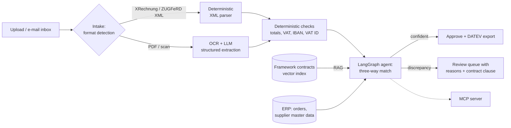

# Belegfluss

**An AI agent (in development) that reconciles supplier invoices with purchase orders, delivery notes and framework contracts, and only escalates what a human really needs to look at.**

[](https://github.com/<your-github-user>/belegfluss/actions/workflows/ci.yml)


> Status: **week 1 of 6**. The domain model, a labeled synthetic dataset and the document
> intake API are done. Extraction, RAG and the agent follow (see [Roadmap](#roadmap)).

## Why

Germany is moving B2B invoicing to structured e-invoices. Receiving them has been mandatory
since 2025; issuing them becomes mandatory on 1 January 2027 for companies with more than
EUR 800,000 annual turnover and on 1 January 2028 for everyone else. Invoices are therefore
turning into machine-readable XML (XRechnung, ZUGFeRD).

The documents an invoice has to be checked *against* are not: delivery notes are signed on
paper at goods receipt and scanned, order confirmations arrive as PDFs, and the prices that
apply are written in framework contracts. Accounts payable teams still compare these by hand.

Belegfluss automates that **three-way match** (order, goods receipt, invoice) and adds the
fourth source most tools ignore: the contract.

## What it will do (end of week 6)



Design principles:

- **XML first.** Structured e-invoices are parsed deterministically; the LLM is only used for
  documents that have no structure ([ADR 0001](docs/adr/0001-xml-first.md)).
- **Rules before models.** Arithmetic, VAT IDs and IBAN checksums are checked in code, never
  by an LLM.
- **Every finding is explained** with the document line and, where relevant, the contract clause.
- **Documents are untrusted input.** Text inside a PDF must never be able to steer the agent
  (prompt-injection tests arrive in week 5).
- **Measured, not demoed.** Every component is evaluated against labeled ground truth in CI.

## The synthetic dataset

Real purchasing documents contain personal and commercial data, so Belegfluss ships its own
generator ([ADR 0002](docs/adr/0002-synthetic-labeled-data.md)). One seed reproduces the whole
world: one buyer, a pool of suppliers, one framework contract per supplier, and N purchase cases.

```bash
belegfluss-synth --sets 200 --seed 42 --out data/synthetic
```

| Document | Formats (share) |
| --- | --- |
| Invoice | XRechnung CII XML (45 %), ZUGFeRD hybrid PDF (20 %), plain PDF (25 %), scan (10 %) |
| Delivery note | PDF (60 %), scan with skew, noise and blur (40 %) |
| Purchase order | JSON export from the buyer's ERP |
| Framework contract | Multi-page PDF with clauses and a price list (Anlage 1) |

About 45 % of the sets contain one or two injected discrepancies. Each is labeled with its
type, line, expected and actual value and, where it applies, the contract clause that proves it.

| Discrepancy | Example | Evidence |
| --- | --- | --- |
| `price_above_contract` | Unit price 3-12 % above the agreed price | Contract, Anlage 1 |
| `volume_discount_missing` | Quantity qualifies for the contract's volume discount, not applied | Contract clause |
| `quantity_exceeds_delivery` | More units billed than the delivery note confirms | Delivery note, contract |
| `item_not_ordered` | Unordered article or an unagreed freight surcharge | Purchase order, contract § 3 |
| `wrong_vat_rate` | 7 % instead of 19 % (or vice versa) | Product master data |
| `totals_inconsistent` | Gross amount does not equal net + VAT | Arithmetic |
| `payment_terms_deviation` | Skonto dropped or shorter payment period | Contract clause |
| `bank_details_changed` | Valid IBAN that differs from supplier master data (payment fraud pattern) | Master data, contract clause |

To keep the task honest, clean sets also contain **legitimate variations that must not be
flagged**: partial deliveries billed correctly, articles without a contract price, applied
volume discounts, and suppliers describing articles in their own words ("RKL 6204-2RS"
instead of "Rillenkugellager 6204-2RS").

Ground truth is written to `ground_truth/`, never next to the input documents.

## Quickstart

Requires Python 3.12 or newer; CI tests 3.12 and 3.15.

```bash
python -m venv .venv && source .venv/bin/activate
make install          # package + dev and generator extras
make check            # ruff, mypy --strict, pytest
make data             # 200 labeled document sets in data/synthetic
make run              # API on http://localhost:8000/docs
```

Upload a document; the format is detected from its bytes, not its file name:

```bash
curl -F "file=@data/synthetic/sets/SET-0001/invoice.xml" http://localhost:8000/v1/documents
```

```json
{"document_id": "6f0c…", "filename": "invoice.xml", "format": "xrechnung_cii",
 "size_bytes": 9672, "sha256": "…", "embedded_einvoice": null}
```

(The invoice of a given set may be `.xml`, `.pdf` or `.png`, depending on its generated format.)

With Docker: `docker compose up --build`.

## Repository layout

```
src/belegfluss/
  domain/        models (Pydantic), money (Decimal), IBAN / VAT ID checksums, discrepancy taxonomy
  synth/         synthetic world, scenarios, PDF / XML / scan renderers, dataset writer, CLI
  storage/       document store and byte-based format detection
  api/           FastAPI app: /health, /v1/documents
tests/           unit, rendering, dataset and API tests
docs/adr/        architecture decision records
```

## Engineering decisions

- [ADR 0001 – XML first, LLM only for unstructured documents](docs/adr/0001-xml-first.md)
- [ADR 0002 – Synthetic, labeled data instead of real documents](docs/adr/0002-synthetic-labeled-data.md)
- [ADR 0003 – Decimal money, and stated vs. computed totals](docs/adr/0003-decimal-money-and-stated-totals.md)
- [ADR 0004 – Trust bytes, not file names, on intake](docs/adr/0004-byte-based-format-detection.md)

## Roadmap

- [x] **Week 1** – Repo, CI, domain model, synthetic dataset generator, intake API
- [ ] **Week 2** – XML parsing + EN 16931 validation, LLM extraction for PDFs and scans, deterministic checks
- [ ] **Week 3** – RAG over framework contracts, LangGraph matching agent, review queue
- [ ] **Week 4** – Evaluation harness in CI, deployment on Azure Container Apps with Azure OpenAI
- [ ] **Week 5** – Prompt-injection test set and defences, PII masking, MCP server
- [ ] **Week 6** – Tracing with Langfuse, results table, demo video

## Known limitations

- Generated PDFs are not PDF/A-3, so the ZUGFeRD files are structurally correct but not
  archive-conformant. Fine for development, not for real invoice exchange.
- XML output is validated against the EN 16931 XSD. XRechnung business rules (KoSIT
  Schematron) are validated from week 2 on.
- Synthetic addresses come from Faker; postcodes and cities do not always match.

## License

MIT. All company names, people, addresses, IBANs and VAT IDs in the dataset are fictional.
